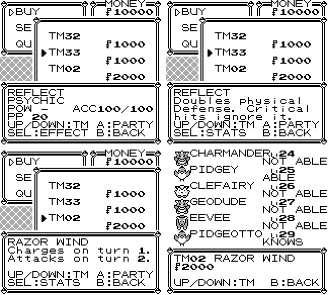

# Move INFO and battle information

In Minimal and Core, INFO describes the move in the game you are playing. A hack can rename a move, change its type or assign it to a different TM. Players can inspect it before buying the TM, choosing a battle move or replacing a move their Pokémon knows.

## What the player does

**Press START wherever you see the INFO hint.** SELECT switches between the move’s stats and effect. When inspecting a machine, A opens the party compatibility screen. B closes INFO. A purchase, withdrawal, move use or replacement still requires its usual confirmation.

| Where | What INFO opens | Where B returns |
|---|---|---|
| A TM/HM in the bag or item PC | The list shows its number and displays the highlighted machine’s move name underneath. START opens the move, even if the bag is full or nobody can learn it. | The same machine and scroll position. |
| A machine for sale or offered as a prize | The offer shows the machine number and price. The highlighted machine’s move name appears below. START opens its details. | The last offer inspected, with its price and currency visible. |
| A Pokémon’s STATS moves page | START opens its first occupied move. Up/down within INFO browses that Pokémon’s known moves in slot order. Outside INFO, the STATS controls continue to change Pokémon and pages. Available for your party and current box outside a link session. | The same Pokémon and STATS page. |
| FIGHT | START opens the highlighted player move, including a copied move in its current slot. Available when choosing a move in a link battle too. | The same battle choice and cursor. No move has been selected. |
| A level-up or machine-teaching decision | At the learn/replace question, START shows the incoming move. At the forget list, START shows the highlighted old move. Inside INFO, left/right switches between the highlighted old move and the incoming move. Label each as known or new. | The same unanswered question or highlighted forget slot, before any write. |

A free move slot still fills automatically at level-up. There is no decision to interrupt. The player can inspect the learned move in STATS. An already-known move or a level with no offer produces no new prompt. Inspecting a known HM is allowed even where forgetting it is forbidden. The unattended Day Care retains its original learning rules. [Stock level-up checks](../research/move-info-stock-checks.json) [Level-up eligibility](https://github.com/pret/pokered/blob/ba9c0568f64ae602fadda577a08c66639f93082a/engine/pokemon/evos_moves.asm#L323-L375) · [Open slot, replacement, cancellation and HM checks](https://github.com/pret/pokered/blob/ba9c0568f64ae602fadda577a08c66639f93082a/engine/pokemon/learn_move.asm#L11-L181)

## What INFO shows

The stats page shows name, type, base power, listed accuracy and base PP (uses per move). The effect page describes what the move does. For regular damage in the reference games, the move’s type determines whether Attack or Special is used. A fixed-damage move should explain its own rule. For a known move, also show current/max PP from the selected slot, including PP Ups. A TM or incoming move has base PP and no personal PP balance. For example, **TM24 Thunderbolt** in English Red/Blue is Electric, has 95 power, 100% listed accuracy and 15 base PP, and can paralyze the target. Retain the machine number so older guides still work. Keep the chosen row’s name, price or quantity legible on the original 160×144 screen. Long names may use a separate selected-row line. [TM mapping](https://github.com/pret/pokered/blob/ba9c0568f64ae602fadda577a08c66639f93082a/constants/item_constants.asm#L160-L185) · [Move data](https://github.com/pret/pokered/blob/ba9c0568f64ae602fadda577a08c66639f93082a/data/moves/moves.asm#L89-L104)

Use meaningful values when the normal power or accuracy formula does not apply. Dragon Rage deals a fixed 40 damage when it connects. Printing the internal power byte as “1 power” would mislead the player. A dash means the move has no conventional base power. Read EFFECT for fixed damage, one-hit knockouts, Counter, or a status move. Listed accuracy describes the move’s data, even when the Gen 1 hit calculation can miss at the nominal maximum. Describe special hit rules where relevant. Show Gust’s type and Focus Energy’s effect as they work in the selected preset. A custom move or rule needs matching text. [Fixed-damage rules](05-mechanics-contract.md) · [Core and Minimal differences](14-features-and-extensions.md#product-presets)

On the move’s stats page, HIGH CRIT identifies a move with an elevated critical-hit rate. PRIORITY identifies a move that goes before ordinary attacks. PRIO/CRIT marks both properties. A tie between two Quick Attacks still uses the game’s normal ordering rules. SELECT opens the effect page. For a high-critical poison move, the stats page shows HIGH CRIT and the effect page still describes poisoning. Editing the high-critical list updates the label automatically. Priority in v0.3.0 is tied to Quick Attack in both the turn-order code and the INFO reader. Authors adding priority to another move must update both places. [Turn order and trait lookup](../../engine/battle/core.asm) · [Reader and labels](../../engine/pokemon/move_info.asm) · [Author and battle checks](../../tests/supply_and_move_info.py)

## Before buying a TM

At a Mart or the Game Corner TM counter, press **START** on a machine. Use **Up/Down** to compare machines without closing INFO. The move, highlighted offer and price change together. A Mart with mixed stock skips ordinary items in this view. Browsing stops at the first and last machine.

**SELECT** changes between stats and effect. The page stays open as you browse: if you are reading what Reflect does, press Down to read Razor Wind’s effect. **A** from either page opens the full party. Each member’s nickname, icon, level and compatibility use the teaching screen layout. **ABLE** means the Pokémon can learn the machine. **NOT ABLE** means it cannot. **KNOWS** means it already has the move, including one acquired through a trade. The footer identifies the machine and the move. At a counter it also shows the price in money or coins. Up/Down compares the same party against another TM.

**B** from any view returns to the latest offer. Your money, coins, Bag and party stay as they were. When checking a TM from the Bag or the item PC, B returns to the item you opened. Regular teaching starts from USE in the Bag.

At the Celadon Department Store, Reflect costs 1,000. One press of Down compares Razor Wind at 2,000 while the effect stays open. A shows the whole party for Razor Wind.

Authors can assign two machines the same move and give a species different compatibility for each machine. Preview and teaching both check the selected machine’s own species flag. [Eligibility lookup](../../engine/items/tms.asm) · [Mart, prize and teaching checks](../../tests/tm_party_info.py)

## Supply INFO

In the Bag, Mart and item PC, START also opens a short description for supported supplies. A Potion shows its healing amount and a Repel shows its step count. The descriptions use the same values as their item effects. B returns to the highlighted row and leaves the purchase, transfer or use unconfirmed. Puzzle key items get no new hints. The [supply table](../../data/items/supply_info.asm) lists the supported items.

## Controls and battle state

Resolve the move from the highlighted item, party or box record, pending move ID, or active battle slot. Use the item’s move table for machines and preserve caller-owned menu state. The stock item list watches A/B/SELECT. The normal FIGHT list masks START. The learn/forget and prize screens have their own input handlers. Handle a fresh START press in each relevant screen before its confirm branch. Ignore held inputs until release when returning. B from INFO must leave the original question unanswered. [Item list](https://github.com/pret/pokered/blob/ba9c0568f64ae602fadda577a08c66639f93082a/home/list_menu.asm#L38-L93) · [Battle and move-menu inputs](https://github.com/pret/pokered/blob/ba9c0568f64ae602fadda577a08c66639f93082a/engine/battle/core.asm#L2554-L2639) · [Prize input](https://github.com/pret/pokered/blob/ba9c0568f64ae602fadda577a08c66639f93082a/engine/events/prize_menu.asm#L12-L42)

Inspection leaves inventory, money, coins, PP, selection for SELECT swaps, last-move history, AI decisions and the turn intact. FIGHT reads active moves after Transform or Mimic. A PP-restoring item uses the selected **party** record and can target a different move. Avoid borrowing a battle calculation that overwrites damage or remembered move state just to draw text. Preserve the battle’s original random draws. Extra time reading can affect frame-driven randomness like any other delay. Compare actual battle choices under controlled rolls. [STATS PP display](https://github.com/pret/pokered/blob/ba9c0568f64ae602fadda577a08c66639f93082a/engine/pokemon/status_screen.asm#L331-L381) · [Item target](https://github.com/pret/pokered/blob/ba9c0568f64ae602fadda577a08c66639f93082a/engine/items/item_effects.asm#L1954-L2002)

## Separate developer choices

The planned live overlay identifying both battlers’ types is a separate developer feature. It can reveal a disguised opponent or a type changed during battle. Its visibility policy must account for ghosts, switching, Transform and Conversion. Matchup advice, hidden opponent data and damage forecasts also fall outside the static move reference. An author can provide these separately. Emerald Expansion’s move-description and type-indicator settings illustrate this separation. Its GBA L-button binding is specific to that hardware. [Emerald Expansion source comparison](../research/evidence.md#e104)

## Acceptance criteria

- Open, close and reopen INFO on each caller in both presets. Compare purchase, cancellation, teaching, refusal and forgetting against the same action without inspection. Cover all four move slots, no eligible Pokémon, empty slots, forced moves, unowned machines and full inventories. Preserve names, amounts, PP and move order.
- At level-up with four moves, inspect the incoming move, inspect each old move, then decline. Repeat and replace one legal move. Test an HM refusal and return, an empty slot, a duplicate move, and the next level-up during a battle. Use the actual prompt and check that only the confirmed replacement writes data.
- In battle, exercise zero PP, copied moves, an item target, a pending swap, the next Counter, both battle sides and matching link builds in both roles. Opening INFO on one endpoint must not submit a command to its peer. Test stock timing separately from matched-roll outcomes.
- Verify descriptions for fixed damage, status, variable power, special accuracy and preset-specific effects. Change a machine mapping and a move’s type in an author build. Verify bag, PC, shop, prize, STATS, FIGHT and learning screens agree. Check long names and text at original resolution.
- When implementing the optional type overlay, test it separately with static INFO available. Preserve concealed identities when disabled or unknown. [Core release checks](09-roadmap.md#public-release-checks)
