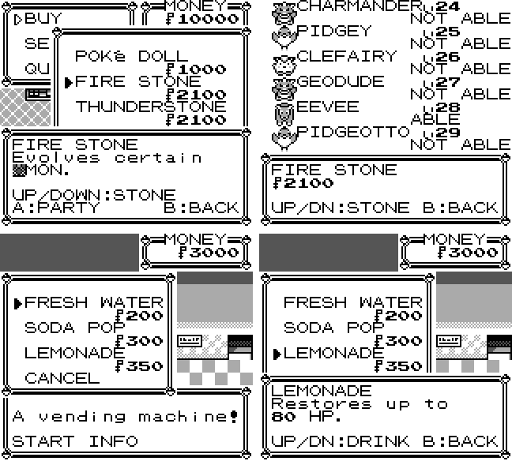

# What changes when you play?

Choose **Minimal** for the original Red/Blue battle and team-building rules with clearer menus, displays and safeguards. Choose **Core** if you also want fixes to battle rules and conveniences such as switching EXP. ALL off between battles. Red and Blue keep their version differences. Green plays like Blue in either preset. [Play a release](../../README.md#play-a-release)

## Battle examples

| Change | Preset | What happens |
|---|---|---|
| Damage feedback on two-type targets | Both | The message and sound account for both types. If one weakness and one resistance cancel out, you get neutral feedback. The original game could announce only one of the two. |
| Focus Energy and Dire Hit | Core | Both raise the user’s critical-hit chance. The original calculation can lower it. Ordinary critical hits keep their Gen 1 rules. |
| Blaine’s Super Potion | Core | At full HP, Blaine takes his normal action and keeps the potion use. |
| Gust and Ghost attacks | Core | Gust is Flying. Lick deals double damage against a pure Psychic type. Night Shade still deals damage equal to the user’s level. Minimal retains Normal Gust and the original type chart. [Evidence](../research/core-rule-precedents.md) |
| Disable and Struggle | Core | If all usable moves are out of PP and the only move with PP is disabled, the Pokémon uses Struggle. PP Ups cannot make an empty move selectable. |
| Thunder and Soul Badges | Core | Thunder boosts Speed and Soul boosts Defense, matching the Gym Leaders’ dialogue. The size of the boosts and the original badge-stacking rules still apply. |
| New level-one Pokémon on the Medium Slow growth curve | Core | It starts with zero EXP. In Minimal, the original calculation can take it straight to level 100 on a small first award. |

[Battle rules and tests](04-bug-triage.md#battle-calculation-and-trainer-repairs)

## Battle displays

In Minimal and Core, a small Poké Ball beside an identified wild opponent means your Pokédex already records that species as owned. Trading for a species counts, and releasing your last copy keeps the mark. It also works on ordinary Safari encounters. A hidden Tower ghost and the Old Man’s demonstration show no ball.

Below your Pokémon’s HP, the EXP bar shows how far it has progressed from its current level to the next. Switching Pokémon changes the bar. A knockout updates it during the existing EXP message. At maximum level the track is empty. [Display rules and author settings](../research/battle-hud-displays.md)

Both presets reserve the final HP-bar pixel for full health. At 258/259 HP you can now see the gap in battle, in the party and in STATS. [HP and level-one experience checks](../../tests/hp_and_level_one.py)

Core also adds **BATTLE PACE** to OPTION. NORMAL is the default. QUICK shortens four pauses in ordinary battles, including the pause when recalling a Pokémon. Music, controls and the game clock keep their normal speed. Link battles, the Safari Zone and catching demonstrations use normal pacing. [Pace checks](../../tests/battle_pace.py)

## Field moves, storage and team building

| When you… | What happens |
|---|---|
| Face a cuttable tree, a usable shore or a pushable boulder | Press A and confirm Cut, Surf or Strength if a party member can use it here. Fly and Flash keep their existing menu commands. |
| Register a Bicycle or a fishing rod from the Bag | Press SELECT in the field to use the registered item. All three rods work. The shortcut follows the same fishing and riding rules as USE. The Bag marks the registered item with SELECT. Registering a different item moves the mark. |
| Reorder a party of two or more in the field | Press SELECT on one Pokémon, move to the other and press A or SELECT to swap them. B cancels. The explicit SWITCH command also works. |
| Fill both your six-member party and your current box | Change boxes at a PC before catching another Pokémon. The chooser shows occupancy. Highlight a box and press START to view its Pokémon. Page with the D-pad and press B to return. Press A on a box and confirm to save and make it the new destination. |
| Leave the first box change without choosing a box | Your previous save keeps its party and its stored Pokémon. Retail Red/Blue can mark its inactive boxes empty. |
| Want to forget a move, including an HM | In Core, visit the Move Deleter in the Fuchsia house between the Pokémon Center and Bill’s family. Choose a Pokémon, then highlight a move. START shows its details and lets you compare the other moves. B returns to the highlighted move. The final question names the move and starts on NO. He refuses to remove the last move. Minimal keeps the original HM commitment. |

Passing up Recover at level 31 still matters for Alakazam in both presets. A party-menu Move Reminder, direct moves between boxes and automatic placement of catches are planned extensions. [Field eligibility](../research/field-shortcut-contract.md) · [Storage design](../research/storage-policy-and-code.md) · [Move services](../research/exp-pacing-and-move-services.md)

## Menus and travel

- Press SELECT in the Pokédex to switch from number order to an alphabetical list of species you have seen. A seen species stays selected across the two views. If you started on an unseen number, returning to number order restores that row. Species you have only seen still hide the details that require catching them.
- The Bag and item PC show the item and chosen quantity when you confirm TOSS. You can cancel before losing anything.
- In an unlit Rock Tunnel, OPTION is readable and the map is dark again when you close it. On the Town Map, the first directional press advances from Route 1 and the Power Plant.
- In Core, both Cycling Road guards turn you back if you have no Bicycle, even when you hold Left through the warning. Minimal keeps the original gate behavior.

[Field and Town Map checks](../../tests/field_sweep.py) · [Pokédex, TOSS, party and fishing checks](../../tests/field_menu_features.py)

## Protecting EXP. ALL

Oak’s aide gives EXP. ALL once. Both presets refuse to toss or sell it and still let you deposit or withdraw it at the item PC. Core starts with sharing on. The Bag shows ON or OFF beneath EXP. ALL. Choose TURN OFF or TURN ON to change sharing between battles. While it is on and in the Bag, Pokémon that fought can earn both a battle share and a party share. Other party members can earn the party share. Fainted Pokémon earn neither. Minimal starts sharing when you carry the item and stops when you deposit it. It keeps the original award calculation. [Item protection](13-playthrough-intake.md#pn-001) · [Experience awards](../research/foundation-audit.md#exp-all-gives-too-little-to-a-party-with-multiple-participants)

## Inspect a move

Highlight a TM or HM and press START for its move’s type, power, listed accuracy and PP. SELECT switches to the effect and back. At a Mart or the Game Corner, press Up/Down to compare offers on the same page. A shows your whole party and who can learn the move. B returns to the last machine you inspected, ready to buy if you choose. In STATS or FIGHT, Up/Down compares your moves without closing INFO. B from FIGHT’s INFO leaves the last inspected move highlighted for your next choice. When a Pokémon with four moves can learn another, press START before answering or while choosing what to forget. Up/Down browses its four old moves. Left/Right compares your candidate with the new move on the same page.

At the Celadon stone counter, press START on a stone and A to check your party. ABLE means that Pokémon can use the stone. Browse another stone with Up/Down or press B to return to the counter. At the rooftop vending machine, START shows the drink's healing amount. Up/Down compares drinks and B returns to the highlighted price. Press A at the machine to buy.

START also shows what an ordinary supply does before you buy, use or withdraw it. For example, a Potion tells you how much HP it restores in the game you are playing. [Move and supply INFO](15-battle-information.md)

## Hidden coins at the Game Corner

The Coin Case holds 9,999 coins. In original Red and Blue, finding a hidden pile with the Coin Case credits what fits and marks the whole pile collected. The game reports the size of the pile. If the resulting balance is 9,999, it adds “Oops! Dropped some coins!” It tests the ending balance, so it can give that warning when every coin fit.

| Before finding 10 | Kept | Lost | Original warning | Minimal and Core warning |
|---:|---:|---:|---|---|
| 9,988 | 10 | 0 | No | No |
| 9,989 | 10 | 0 | Yes | No |
| 9,990 | 9 | 1 | Yes | Yes |
| 9,999 | 0 | 10 | Yes | Yes |

Surplus coins cannot be collected on a later visit. Without the Coin Case the pile stays available. The project changes only the false warning in this example. The distinct Core repair for a pile encoded as 40 and the paid clerk’s original transaction have their own records. [Pickup and collection flag](https://github.com/pret/pokered/blob/ba9c0568f64ae602fadda577a08c66639f93082a/engine/events/hidden_items.asm#L52-L132) · [Original text](https://github.com/pret/pokered/blob/ba9c0568f64ae602fadda577a08c66639f93082a/data/text/text_2.asm#L764-L783) · [Paid clerk](../research/game-corner-redemption.md)

## Finding a specific change

| Subject | Maintained record |
|---|---|
| Battle rules, including Ghost against Psychic, Gust, Charizard and retained Gen 1 mechanics | [Mechanics contract](05-mechanics-contract.md) and [case-specific evidence](../research/core-rule-precedents.md) |
| Pokémon, items, field actions, menus, shops, the PC and the playthrough findings | [Playthrough change register](13-playthrough-intake.md) |
| Battle, map, text, audio, display and save defects | [Curated repair register](04-bug-triage.md) and [94 individual catalog decisions](../research/catalog-decisions.md) |
| Additional confirmed faults in the PC and field menus | [Box chooser](../research/box-picker-safety.md) and [Surf refusal](../research/field-shortcut-contract.md) |
| Information and menu changes | [Preset decisions and player effects](../research/sweep-decisions.md) and [v0.2.0 findings](../research/v020-feature-sweep.md) |
| Day Care and prize redemption | [Why Day Care keeps its original rules and dialogue](../research/day-care-history.md) · [Buying Porygon at the Game Corner](../research/game-corner-redemption.md) |
| Developer choices and their limits | [Feature catalog](14-features-and-extensions.md), [tutorial coverage](../research/tutorial-library.md) and [engine changes by size](../research/refactor-scope.md) |

## Recording a change in the game repository

Every difference from upstream needs a record, including intentional preservation of an old result on one path of a shared fix. Give it one home. Reuse an existing playthrough or bug ID. Link the same entry from the release notes and from related fixes. A group of changes can share one entry when it describes every affected behavior explicitly. Before tagging a release, compare it with the preceding release and the upstream baseline. Match each changed rule, default, data set, interface, save format and asset choice to its entry. A code-only refactor can have one technical note covering all affected callers.

Start with what a player does and what happens. State what stock does, which builds change it, and why. Give an example where the difference matters. For a simple typo, the old and corrected wording can be the whole example. For a developer feature, show how to select it once the setting exists. Record the first game release containing the change; until then say planned, tested in a prototype, or implemented as appropriate.

Keep the main entry short. Link the source, the before-and-after check and any remaining uncertainty underneath. Describe save files, link play or other options only where they are affected. For an internal change with identical play, name the shared routine and the comparison that verified the old result. Readers should be able to tell what their players will notice and how to verify it in their own build.
