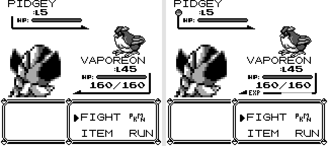

# A caught marker and an EXP bar for battle

**Recommendation under review.** Enable both displays in Minimal, Core and Extended, with separate build-time choices for hack authors. Use an instant EXP update in the reference presets. The existing spec lists both as optional author features. Neither display ships in v0.1.2. [Current tutorial inventory](tutorial-coverage.csv) · [Earlier marker decision](player-experience-sweep.md)

Left is a Red Core battle in SameBoy. Right is a display study of the same frame with Pidgey marked owned and Vaporeon three-eighths of the way to its next level. The marker uses the existing Pokédex ball. The EXP label and 48-pixel meter fit in the player panel’s existing bottom edge. Only those two areas change. This checks one layout at native 160×144 resolution. The preview uses a fixed fill and does not exercise the award or visibility logic.

## The caught marker

The ball means **this species has been registered as owned in this save**. Trades, gifts and evolutions can qualify. Releasing the last copy leaves the record intact. A seen-only species gets no ball. Catch odds, bag contents and available box space have no bearing on the mark.

Red/Blue already shows this same ball in the Pokédex. Gold/Silver puts a ball in tile column 1, row 1 for an owned wild opponent. FireRed’s Kanto implementation skips unidentified ghosts, trainer fights and catching demonstrations. These are useful precedents for a deliberate convenience. [Red/Blue’s owned mark](https://github.com/pret/pokered/blob/ba9c0568f64ae602fadda577a08c66639f93082a/engine/menus/pokedex.asm#L249-L260) · [Gold/Silver battle mark](https://github.com/pret/pokegold/blob/2bbfba60051acfbed96d68fb5e40173a06df67d8/engine/battle/trainer_huds.asm#L134-L151) · [FireRed restrictions](https://github.com/pret/pokefirered/blob/ce6406d8c2eaf46d543c8a2606de0c3cb1951982/src/battle_interface.c#L1551-L1574)

- After the player receives the Pokédex, draw the ball under a known wild opponent’s name, beside the level or status. Include ordinary Safari encounters. The player may spend a scarce Safari Ball differently with the reminder visible. That is a real benefit of displaying an existing collection record.
- Suppress the mark in trainer battles, link battles, the Old Man demonstration and while the Tower ghost’s identity is hidden. Suppress it for the scripted Marowak encounter as well. Returning from STATS or a battle animation must never uncover a ghost early. Use the normal mark on an ordinary identified Tower encounter.
- Read the encountered species and the Pokédex’s owned flag. A wild Ditto wearing a different sprite after Transform keeps Ditto’s record. A Substitute or Minimize sprite does not change it. In Extended, hide the mark while a disguise conceals the species from the player. After the reveal, use the author’s Pokédex registration rule for that species or form.
- Reuse the ball artwork through the battle graphics loader. The Pokédex loads its own tiles. Its tile number alone is unsafe to reuse on another screen. [Ball artwork and Pokédex loader](../../engine/gfx/load_pokedex_tiles.asm) · [Battle panel drawing](../../engine/battle/core.asm)

## The EXP bar

Retail Red/Blue STATS shows the player’s exact EXP and the amount needed for the next level. Gold/Silver draws an eight-tile meter beneath the active battler’s HP. Its award sequence can animate progress. For R/B, keep the existing HP fraction, right-hand corner, text box, status and long nicknames. The proposed narrower meter leaves room for a small EXP label. Use light and dark shapes readable on the original monochrome Game Boy. On Super Game Boy, a low-HP color change must leave the meter legible and distinct from HP. [Red/Blue STATS](https://github.com/pret/pokered/blob/ba9c0568f64ae602fadda577a08c66639f93082a/engine/pokemon/status_screen.asm#L383-L408) · [Gold/Silver meter](https://github.com/pret/pokegold/blob/2bbfba60051acfbed96d68fb5e40173a06df67d8/engine/battle/core.asm#L4352-L4387) · [Gold/Silver award animation](https://github.com/pret/pokegold/blob/2bbfba60051acfbed96d68fb5e40173a06df67d8/engine/battle/core.asm#L7262-L7301)

- Show the active party member’s progress in ordinary wild and trainer battles, including before receiving the Pokédex. Read its party slot, original species and growth curve. A switch changes the bar. Transform keeps the real party member’s curve. Safari battles and the Old Man demonstration have no player-owned active battler to display. Omit the meter in link play.
- Measure progress from the current level threshold to the next. For a bar of width W, fill `floor(W × (total EXP − current threshold) / (next threshold − current threshold))` pixels, bounded to the meter. Use the game’s growth routines, handle the lowest supported level, and avoid overflow when scaling the three-byte EXP value. At the maximum level show an empty, inactive track and skip the next-level lookup.
- Refresh after the existing game logic awards EXP and resolves level changes. A benched recipient must never fill the active battler’s bar. Preserve each preset’s own EXP. ALL rules, stat experience, fainting, move learning, evolution and capture rewards. A stock capture earns no EXP. The reference display adds no pause, input, random roll or sound. An optional animated fill can later run during the existing award text, with its own timing tests. [Party awards and level changes](../../engine/battle/experience.asm) · [STATS growth calculation](../../engine/pokemon/status_screen.asm)

**Why Minimal qualifies.** A player who remembers their Pokédex and checks STATS already has both facts. A visible reminder can affect a decision. With the same action and rolls, it gives the same battle result and spends the same resources. That is the distinction already used for move INFO. Preserving the exact retail panel is a reasonable author preference, so each display should be removable independently. Live matchup advice, damage forecasts, new catch rewards and party-wide EXP remain separate choices. [Preset criteria](../docs/14-features-and-extensions.md#product-presets) · [Move INFO contract](../docs/15-battle-information.md)

**What other Gen 1 hacks demonstrate.** Yellow Legacy implements the mark and an EXP display. Solus documents both and a correction for the EXP bar following the HP color. Shin lists an EXP bar in its additional features. PureRGB offers the bar and defaults it off. This is evidence that the features are worth sharing and that authors differ on the default. [Yellow Legacy marker](https://github.com/cRz-Shadows/Pokemon_Yellow_Legacy/blob/15169d137e2ef778e8765f7f3381acc4093dc169/engine/battle/core.asm#L1996-L2015) · [Yellow Legacy bar](https://github.com/cRz-Shadows/Pokemon_Yellow_Legacy/blob/15169d137e2ef778e8765f7f3381acc4093dc169/engine/battle/core.asm#L7042-L7068) · [Solus](https://github.com/Dechrissen/poke-solus-rgb/blob/95e157191e920162a24908cc95c358e73d294689/docs/FEATURES.md#L432-L437) · [Shin](https://github.com/jojobear13/shinpokered/blob/a7a9b1361e55aaa5afed6b5d14b5e7bd44002179/README.md#L222-L229) · [PureRGB](https://github.com/Vortyne/pureRGB/blob/c45336e2874d45e48d571ee92a5ce587cca05d65/FEATURES.md#L53-L57)

## Checks before enabling either default

1. Build all four on/off combinations. With both off, compare the battle panels with v0.1.2. With either enabled, compare matched actions and rolls, party records, EXP and stat EXP, inventory, catch outcome, move learning and turn order. Exercise linked consoles with both cable roles.
2. Test an unknown species, seen-only, traded, evolved and released species, with and without the Pokédex. Recheck on a full box, in Safari, in the tutorial, before and after a Tower reveal, after Transform, and after returning from STATS or INFO. Assert both the presence and the absence of the ball.
3. Test zero progress, just below a threshold, one level, multiple levels and the cap across the supported growth curves. Cover switches, fainted and benched recipients, traded Pokémon, EXP. ALL, no gain and a new move offered mid-award. Compare to the party/STATS numbers after every settled award.
4. Capture the mixed cases on DMG and Super Game Boy across the reference colors. Check status text, long names, maximum HP digits, fainting, low HP and redraws with animations on and off. Verify live tile use and measure the frame and memory cost on the built game. A one-screen mockup cannot settle these checks.
